# Walkthrough Challenge 1 - Assessment and migration with SQL Server Management Studio (SSMS) and GitHub Copilot

**[Home](../../Readme.md)** - [Next Challenge Solution](../challenge-02/solution-02.md)

## Assessment and migration with SQL Server Management Studio (SSMS) and GitHub Copilot

In this challenge **GitHub Copilot is your companion throughout the whole migration**. After the preparation steps you will find suggested Copilot prompts in every section. Use them to understand what you are doing, to analyze the results of the assessment, and to remove migration blockers.

### Contents

[Migration architecture and Azure components](#migration-architecture-and-azure-components)

[Generic Migration Content](#generic-migration-content)

[1. Preparation](#1-preparation)
* [1.1 Connect to your Win11 VM](#11-connect-to-your-win11-vm)
* [1.2 Connect SSMS with your Azure and GitHub Copilot accounts](#12-connect-ssms-with-your-azure-and-github-copilot-accounts)
* [1.3 Connect to the legacy SQL Server](#13-connect-to-the-legacy-sql-server)
* [1.4 Connect to the Azure SQL Managed Instance](#14-connect-to-the-azure-sql-managed-instance)
* [1.5 Say hello to GitHub Copilot](#15-say-hello-to-github-copilot)

[2. Understand the migration path and assess the databases with GitHub Copilot](#2-understand-the-migration-path-and-assess-the-databases-with-github-copilot)

[3. Remove the migration blockers with GitHub Copilot](#3-remove-the-migration-blockers-with-github-copilot)

[4. Migrate the application databases to Azure SQL Managed Instance](#4-migrate-the-application-databases-to-azure-sql-managed-instance)

[5. Confirm the application databases have been migrated to Azure SQL Managed Instance](#5-confirm-the-application-databases-have-been-migrated-to-azure-sql-managed-instance)

[Annotations](#annotations)

# Migration architecture and Azure components


# Generic Migration Content
| **Narrative**  | **Notes**  |
|:-----|:-------|
| *Notes for outside of the workshop:*  *Familiarise yourself with the new Microsoft migration capabilities with SQL Server Management Studio and Migration options by using Arc* | Migrate SQL Server to Azure SQL (SSMS): [https://learn.microsoft.com/en-us/ssms/migrate/migrate-sql-server-azure-sql?tabs=sql-standard](https://learn.microsoft.com/en-us/ssms/migrate/migrate-sql-server-azure-sql?tabs=sql-standard) This article covers the migration from Arc-Enabled SQL Server instances and Non Arc-Enabled SQL Server instances. For Non Arc-Enabled SQL Server instances there will be no performance-based sizing recommendation. |

# 1. Preparation

Before you start with the migration, you need to prepare your lab environment. You will connect to the lab machine, link your Azure and GitHub Copilot accounts, and connect to both the legacy SQL Server and the Azure SQL Managed Instance.

## 1.1 Connect to your Win11 VM

|**Narrative**| **Screenshot**| **Notes**|
|:------------|:--------------|:---------|
|Connect to the Azure Portal with <secret group="Azure" name="Entra ID Username" show="true"></secret> and password <secret group="Azure" name="Entra ID TAP"></secret>.<br>In the Azure Portal open your Win11 VM <secret group="Lab-General" name="Team VM Name" show="true"></secret>.<br>Connect to the VM with Bastion with the following VM connection credentials Username <secret group="Lab-Credentials" name="VM User Name" show="true"></secret> and password <secret group="Lab-Credentials" name="VM User Password"></secret>.<br>Please make sure to select the correct keyboard language.|| |
|On the Win11 VM you will find a shortcut for SQL Server Management Studio (SSMS).| 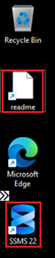| |
|Start SQL Server Management Studio (SSMS) from the Start menu or the desktop icon.||SQL Server Management Studio (SSMS) is a free download from Microsoft. Since SSMS 22.5 it supports the assessment and migration of SQL Server databases to Azure SQL and it has GitHub Copilot built in.|

## 1.2 Connect SSMS with your Azure and GitHub Copilot accounts

You need two accounts in SSMS: your **Azure account** (to select the Managed Instance during the migration) and your **GitHub account with a Copilot license** (to use the Copilot chat).

|**Narrative**| **Screenshot**| **Notes**|
|:------------|:--------------|:---------|
|In SSMS open the account settings and add your **Azure account**. Sign in with <secret group="Azure" name="Entra ID Username" show="true"></secret> and password <secret group="Azure" name="Entra ID TAP"></secret>.|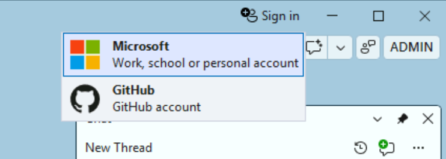|The Azure account is needed later to select the Managed Instance resource in the Managed Instance Link wizard.|
|Confirm that the Azure account and the subscription of the lab are shown in the account list.|<br>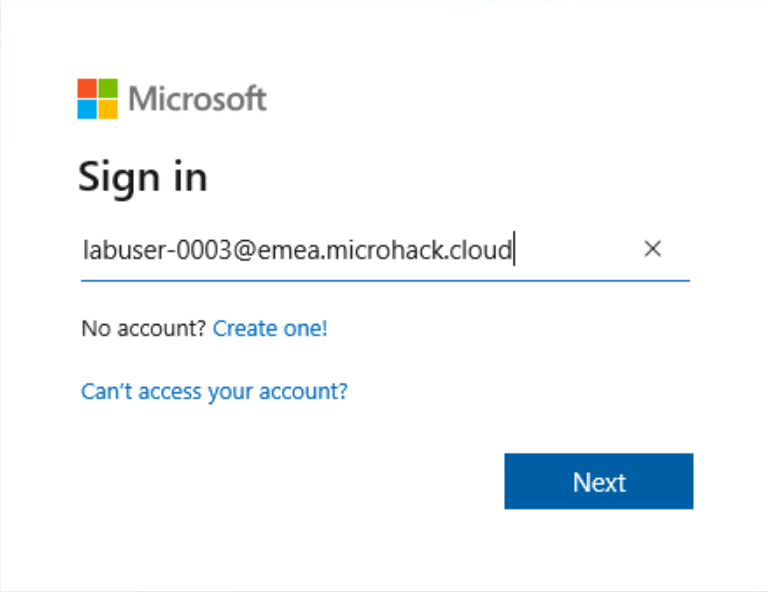<br><br>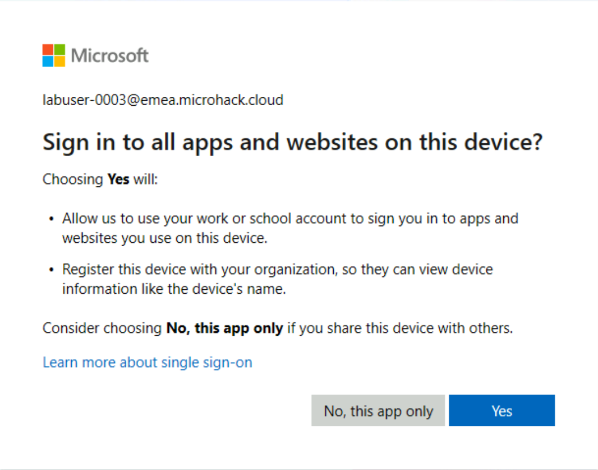<br>||
|Connect to GitHub in SSMS.||**Note**: The GitHub credentials are provided during the Hack.|
|A browser window opens where you can enter your GitHub credentials.|||
|Connect your account with Visual Studio. Click **Continue**.|||
|Authorize Visual Studio to connect with GitHub. Click **Authorize GitHub**.|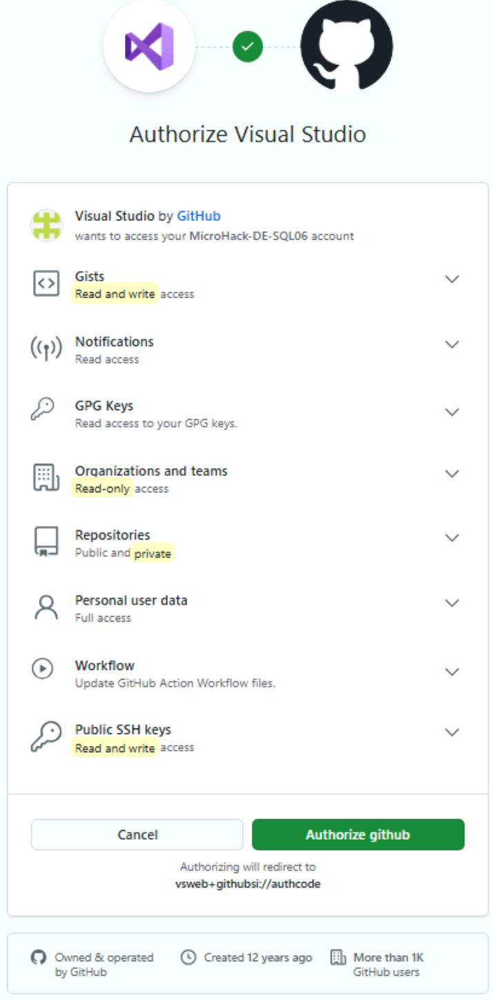||
|Allow the website to open SQL Server Management Studio.|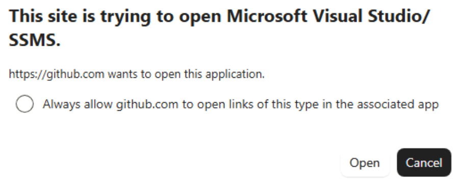||
|GitHub is now connected with SSMS. You can now use the Copilot chat window.|||

## 1.3 Connect to the legacy SQL Server

|**Narrative**| **Screenshot**| **Notes**|
|:------------|:--------------|:---------|
|In the **Connect to Server** dialog connect to **legacySQL2016**. Use **Windows Authentication** and check the **Trust server certificate** checkbox.|||
|In Object Explorer expand the **Databases** node. You should see the databases of your team.||Only work with the databases of your team.|

## 1.4 Connect to the Azure SQL Managed Instance

|**Narrative**| **Screenshot**| **Notes**|
|:------------|:--------------|:---------|
|Connect to your Azure SQL Managed Instance in the **Connect to Server** dialog. Use the Managed Instance host name and the SQL credentials of the lab.|<br><br>|**Note**: The Managed Instance host name and the credentials are provided during the Hack. Check the **Trust server certificate** checkbox if required.|
|Both servers are now visible in Object Explorer. The Managed Instance does not contain your team databases yet.|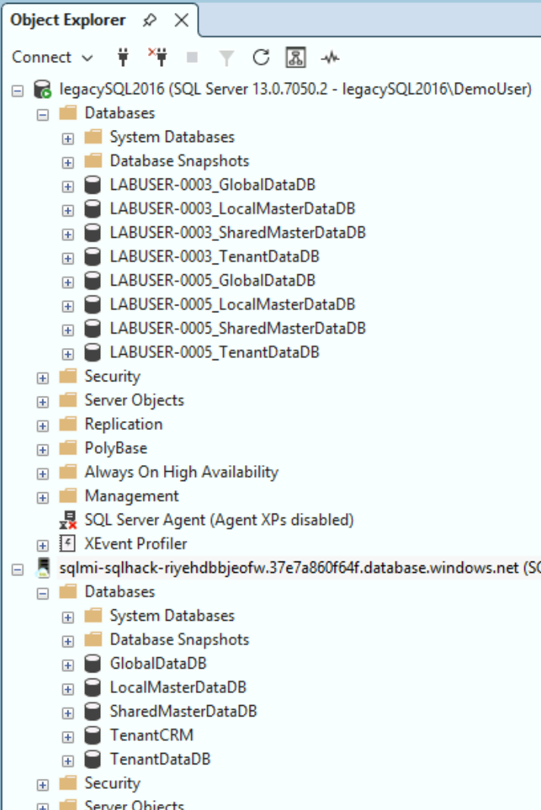||

## 1.5 Say hello to GitHub Copilot

|**Narrative**| **Screenshot**| **Notes**|
|:------------|:--------------|:---------|
|Open the Copilot chat window and ask your first question to verify that everything works.||**Prompt**: *"How can I migrate my database from SQL Server to a Managed Instance?"*|

> **Copilot prompt suggestions in this walkthrough**
>
> Every section below contains a **Prompt** hint. You do not have to use the prompts word for word. Try your own variations, ask follow-up questions, and always **review what Copilot proposes before you execute it**.

# 2. Understand the migration path and assess the databases with GitHub Copilot

In this section we will use SQL Server Management Studio to assess the SQL Server instance databases for suitability for migration to Azure. Ask GitHub Copilot to explain the migration path and the assessment before and while you run it.

|**Narrative**| **Screenshot**| **Notes**|
|:------------|:--------------|:---------|
|Ask Copilot how the migration works.||**Prompt**: *"How can I migrate my database from SQL Server to a Managed Instance?"*|
|Ask Copilot what the migration assessment does before you run it.|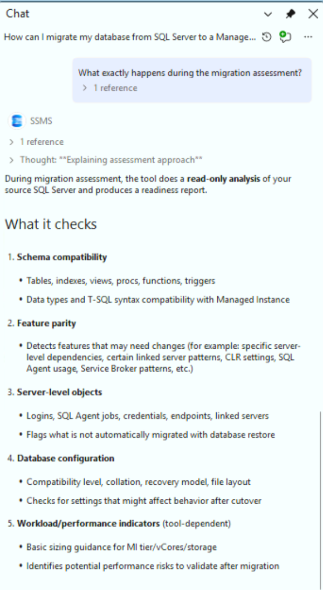|**Prompt**: *"What exactly happens during the migration assessment?"*|
|We need to determine the suitability of the database(s) for migration to Azure. This includes checking for compatibility and feature support with Azure SQL. From the context menu of the **legacySQL2016** instance select **Migrate SQL Server**.||If the context menu is not visible the Hybrid and Migration workload was not installed with SSMS.|
|This opens the main screen for the migration experience.|||
|Click **Run Readiness Assessment**.||The assessment will take some seconds to minutes depending on the number of databases and the amount of database objects.|
|After the assessment completes we will see that only SQL Server on Azure Virtual Machine is available as a possible migration target.|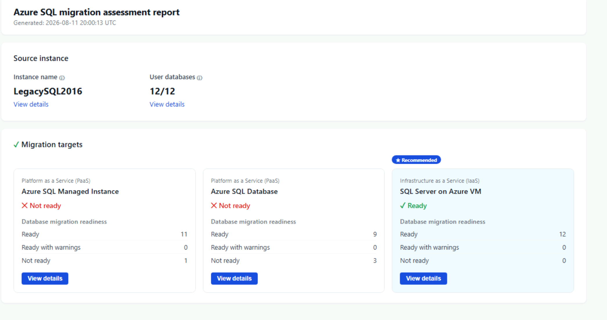||
|Click **View Details** to examine why the migration to Azure SQL Managed Instance will not work for your team databases.|||
|On the detail view you can see which objects are not ready for migration.|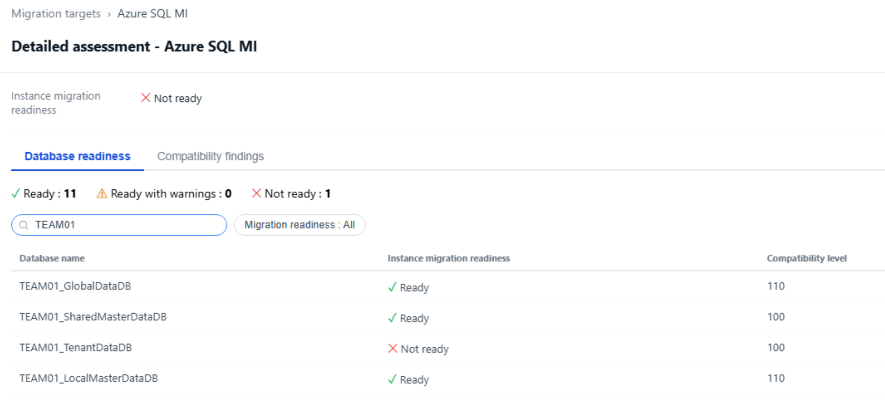||
|Select the **Compatibility Findings**. This will show why the instance cannot be migrated to Azure SQL Managed Instance.||**Note**: This problem seems to be solvable.|
<!--|Ask Copilot to explain the findings and to help you with the next step.|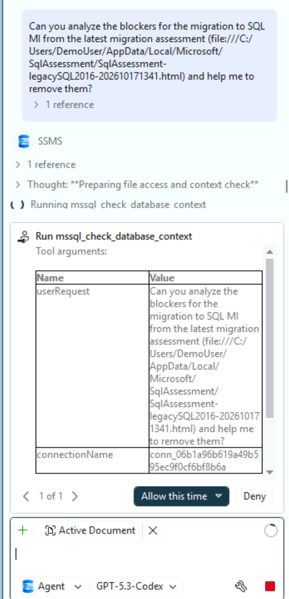<br>|**Prompt**: *"Can you analyze the blockers for the migration to SQL MI from the latest migration assessment \<add path to html file\> and help me to remove them?"*|-->

# 3. Remove the migration blockers with GitHub Copilot

In this section we will leverage GitHub Copilot to mitigate the migration blockers for the databases from SQL Server to Azure SQL Managed Instance.

|**Narrative**| **Screenshot**| **Notes**|
|:------------|:--------------|:---------|
|Use a prompt similar to the following: *The migration assessment tells me that I cannot migrate to Managed Instance. Can you analyze the blockers and give me instructions how I will be able to migrate to MI? "C:\Users\DemoUser\AppData\Local\Microsoft\SqlAssessment\SqlAssessment-LegacySQL2016-202608121317html"* ||**Prompt**: *"Can you analyze the blockers for the migration to SQL MI and help me to remove them?"* You can also add the path of the assessment report to the prompt as shown here.|
|GitHub requests access to the provided assessment report. Please approve access.||**Note**: The access requests could occur several times.|
|GitHub identified the blocker and generates commands to mitigate the blocker.|||
||||
||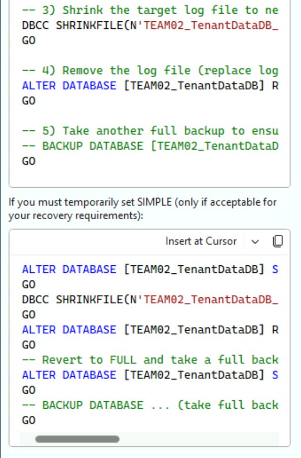||
|You can copy over the commands to a query window to remove the migration blocker. Review the commands before you execute them.|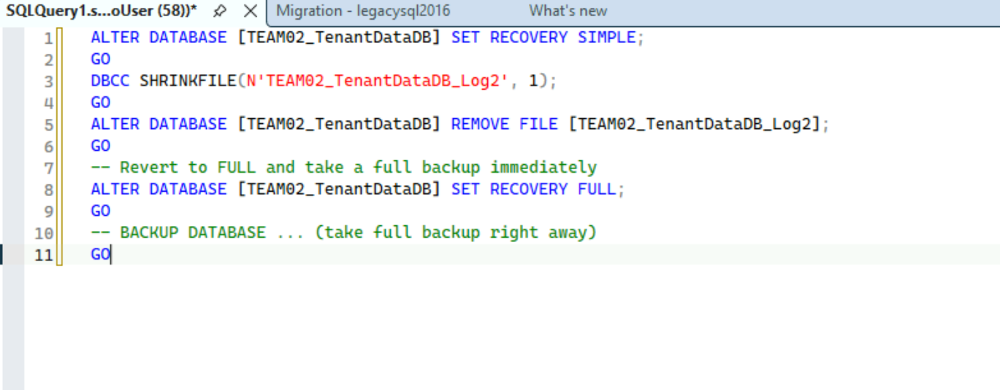|**Hint**: If the database is in Full Recovery Model it might be easier to put the database into Simple Recovery Model, remove the second ldf file, and finally turn the database back into Full Recovery Model. Ask Copilot to generate the script for you.|
|After you removed the migration blocker run the assessment again. Azure SQL Managed Instance should now be a possible migration target without any compatibility blocker.||**Prompt**: *"I removed the blocker. What should I check before I run the assessment again?"*|

**We are now ready to migrate the application databases to Azure SQL Managed Instance.**

# 4. Migrate the application databases to Azure SQL Managed Instance

In this section we will use SQL Server Management Studio (SSMS) to migrate the application databases to Azure SQL Managed Instance by using Managed Instance Link. Keep the Copilot chat open to ask questions about every wizard page.

|**Narrative**| **Screenshot**| **Notes**|
|:------------|:--------------|:---------|
|Ask Copilot what Managed Instance Link is and how the migration with minimal downtime works.||**Prompt**: *"How does the migration with Managed Instance Link work and what are the steps for the cut-over?"*|
|On the central migration experience in SSMS you can now select **Migrate Data** and select the option **Managed Instance Link**.|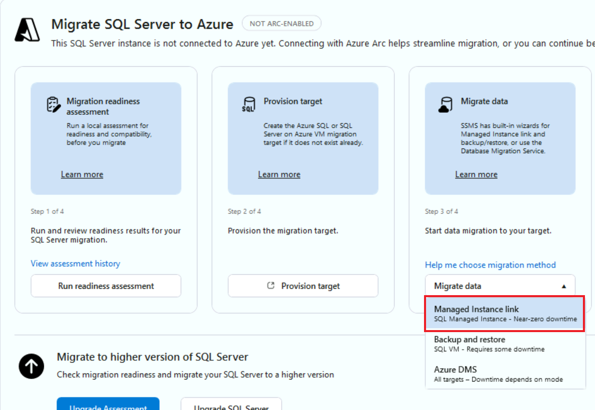| **Note**: Managed Instance Link offers the option for a migration with minimal downtime. You create the Managed Instance Link first. Then you wait until the databases are synchronized. And finally you do the cut-over.|
|On the first screen of the Managed Instance Link Wizard please provide your team name to better distinguish between the migration objects.|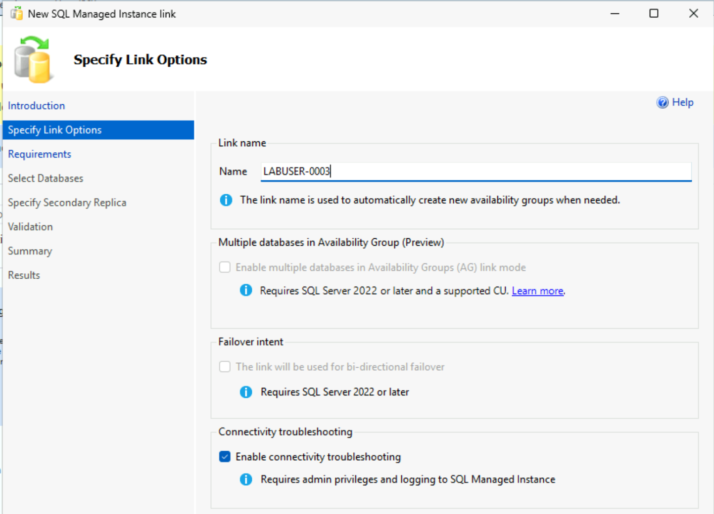||
|The Managed Instance Link will check for MI Link readiness of the instance.||**Note**: The mentioned Trace Flags will make sure that the migration performance is good enough during the migration. The requirements and limitations for Managed Instance Link are listed here [https://learn.microsoft.com/en-us/azure/azure-sql/managed-instance/managed-instance-link-feature-overview?view=azuresql#limitations](https://learn.microsoft.com/en-us/azure/azure-sql/managed-instance/managed-instance-link-feature-overview?view=azuresql#limitations).<br>**Prompt**: *"The Managed Instance Link readiness check shows trace flags. What do they do and do I have to change anything?"*|
|Select only the databases of your team. The databases can only be connected to one MI Link.|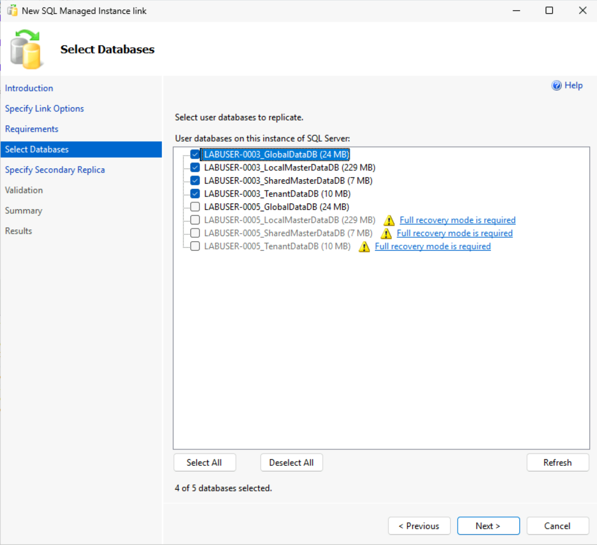||
|Next add the SQL Managed Instance as a secondary replica.|||
|You need to connect to Azure to select the SQL Managed Instance resource. In addition you need to connect to the Managed Instance itself.||**Note**: The credentials are provided during the Hack. You already connected both accounts in the preparation section.|
|The Wizard connects to the Managed Instance and checks the Managed Instance for compatibility. Click **Next**.|||
|You will receive a final summary and an option to generate a script. Click **Finish**.||**Prompt**: *"Please explain the generated MI Link script step by step."*|
|The wizard creates MI Links for all selected databases.|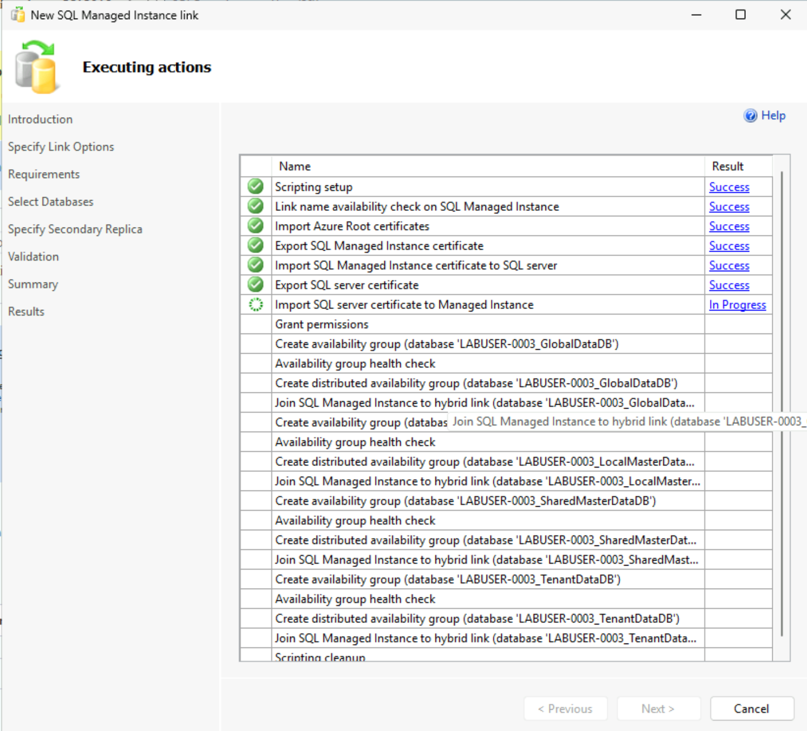|**Note**: This process can take a long time if many databases are involved.|
|The databases are connected to MI Link.|<!---->||
|After the Link was established wait until the databases are synchronized.|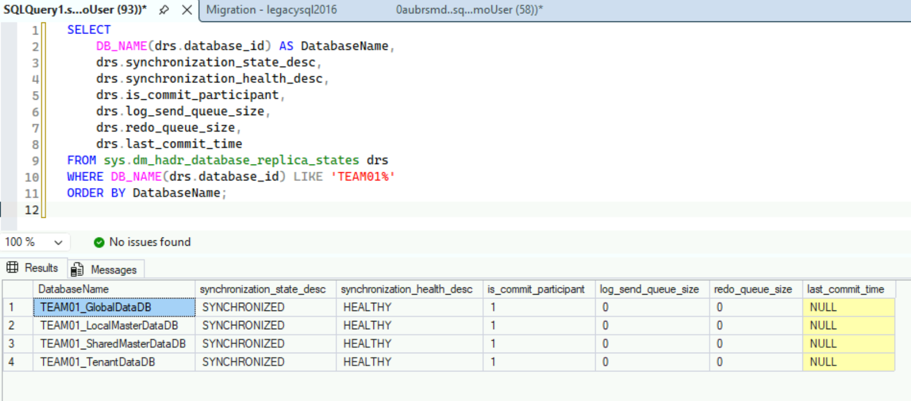|**Prompt**: *"How can I check whether my databases are fully synchronized to the Managed Instance? Please use the T-SQL script from the annotations as a starting point."*|
|You will see multiple availability groups for every database. This is normal.|||
|For the cut-over stop the application connectivity to the legacy SQL Server and do the failover.|||
|For every database of your team use the context menu on the source legacy SQL Server and select **Azure SQL Managed Instance Link**->**Failover...**.|||
|The Managed Instance Link Failover Wizard will check all prerequisites.|||
|If the database is healthy we can only do a Planned Manual Failover. Click **Next**.|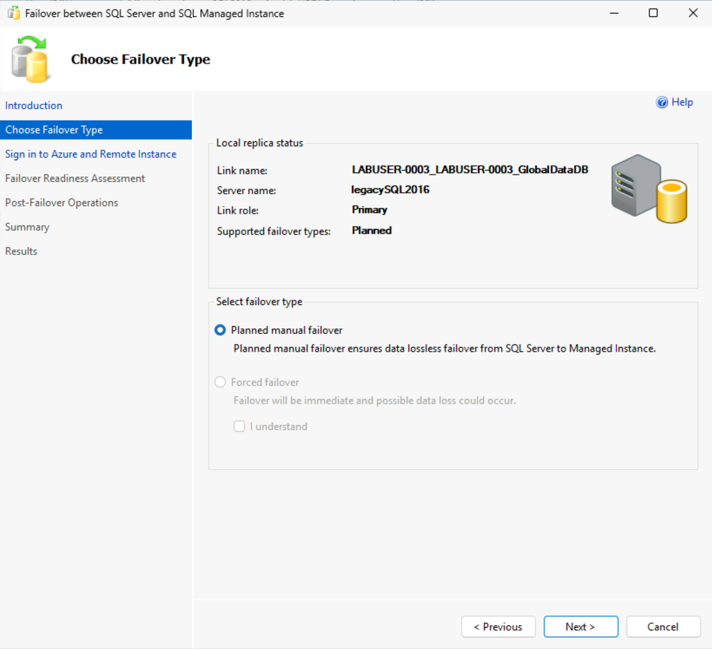|**Prompt**: *"What is the difference between a planned manual failover and a forced failover in Managed Instance Link?"*|
|We have to sign in to Azure and to the Managed Instance again. Click **Next**.|||
|The Wizard checks the readiness for the failover. All looks good. Click **Next**.|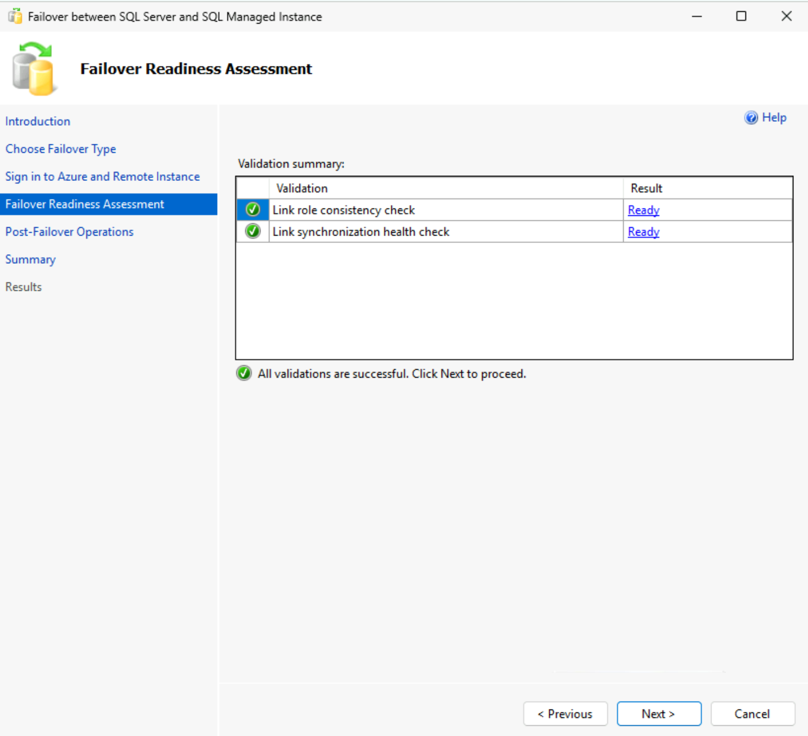||
|Please acknowledge that you should stop application connectivity against the source database and select that the wizard will remove the distributed availability group.|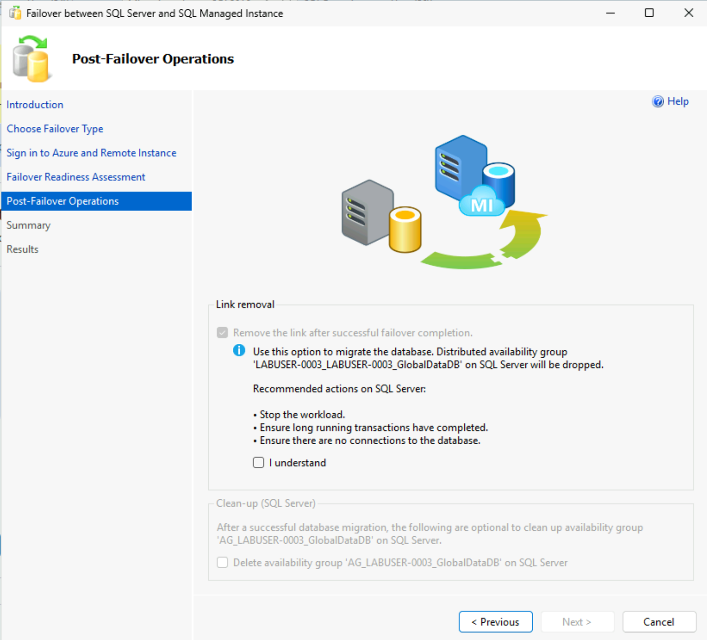|**Note**: After this step you will have two writable copies of the databases on the legacy server and on the Managed Instance.|
|Click **Next**.|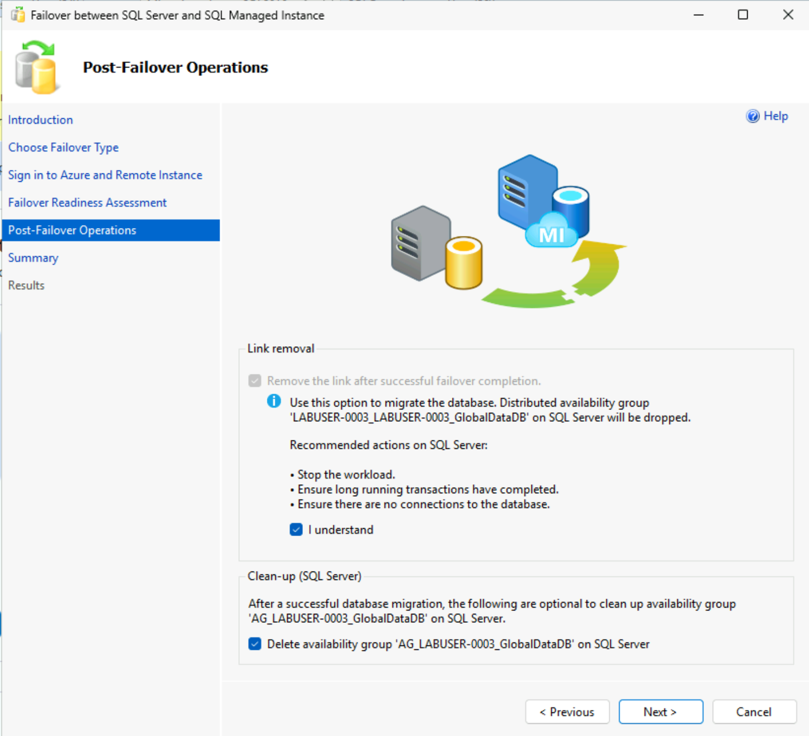||
|You will see a final summary and have the last option to generate a script. Click **Finish**.|<!---->||
|The failover was successful.|<!---->||
|The database is no longer member of the distributed availability group.|||

# 5. Confirm the application databases have been migrated to Azure SQL Managed Instance

|**Narrative**| **Screenshot**| **Notes**|
|:------------|:--------------|:---------|
|In Object Explorer refresh the Managed Instance connection and expand **Databases**. The databases of your team must now be listed and online.|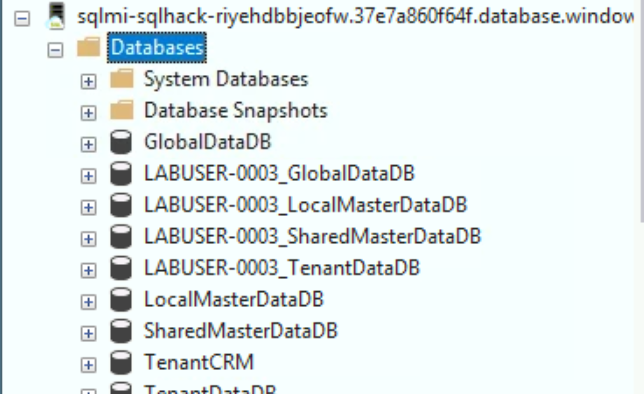||
|Ask Copilot to help you with a final check of the migration.||**Prompt**: *"Which checks should I run on the Managed Instance to confirm that my databases have been migrated successfully?"*|

**Congratulations! You have migrated your application databases to Azure SQL Managed Instance with the help of GitHub Copilot.**


# Annotations
### T-SQL script to check distributed AG status
``` SQL 
SELECT
    DB_NAME(drs.database_id) AS DatabaseName,
    drs.synchronization_state_desc,
    drs.synchronization_health_desc,
    drs.is_commit_participant,
    drs.log_send_queue_size,
    drs.redo_queue_size,
    drs.last_commit_time
FROM sys.dm_hadr_database_replica_states drs
WHERE DB_NAME(drs.database_id) LIKE 'TEAM01%'
ORDER BY DatabaseName;
````
