# Walkthrough Challenge 3 - Security on Azure SQL Managed Instance with GitHub Copilot

[Previous Challenge Solution](../challenge-02/solution-02.md) - **[Home](../../Readme.md)**

## Security on Azure SQL Managed Instance with GitHub Copilot

In this challenge **GitHub Copilot is your security assistant**. You will start with a security review of your database, then walk through the layers of the Azure SQL security model (data classification, vulnerability assessment, threat protection), and finally fix a real vulnerability in a stored procedure. In every section Copilot helps you to understand, analyze and mitigate, and the Azure Portal and SSMS help you to verify the results.

### Table of Contents

[1. Introduction](#1-introduction)

[2. Preparation](#2-preparation)
* [2.1 Lab details](#21-lab-details)
* [2.2 Connect to the Managed Instance](#22-connect-to-the-managed-instance)
* [2.3 Open the GitHub Copilot chat](#23-open-the-github-copilot-chat)

[3. Get a first security overview with GitHub Copilot](#3-get-a-first-security-overview-with-github-copilot)

[4. Data Discovery & Classification](#4-data-discovery--classification)

[5. Azure Defender for SQL: Vulnerability Assessment](#5-azure-defender-for-sql-vulnerability-assessment)

[6. Azure Defender for SQL: Advanced Threat Protection](#6-azure-defender-for-sql-advanced-threat-protection)

[7. Fix the SQL injection vulnerability with GitHub Copilot](#7-fix-the-sql-injection-vulnerability-with-github-copilot)

[Prompt cheat sheet](#prompt-cheat-sheet)

# 1. Introduction

This hands-on lab introduces you to the layered security model available when running databases in Azure. The activities within this hands-on lab will progress from the outer security layers that protect the perimeter of Azure SQL through to the inner layers that protect the information contained within the data.

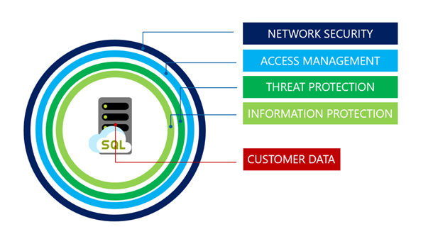

Because SQL Managed Instance always runs in a private network the Network Security layer has already been implemented at the vNet level. Equally we have already defined and implemented Azure AD and SQL Server logins, roles and permissions so the Access Management tier has also been pre-built.

So this lab will focus on the Threat Protection, Information Protection and Customer Data layers of the security model and how these are implemented in Azure SQL Managed Instance through:

- Data Discovery & Classification
- Azure Defender for SQL
  - Vulnerability Assessment
  - Advanced Threat Protection

# 2. Preparation

## 2.1 Lab details

The labs run against the **\<Team\>_TenantDataDb** database that you migrated earlier using  SQL Server Management Studio. The Copilot security review in sections 3 and 7 uses the shared **TenantCRM** database.

## 2.2 Connect to the Managed Instance

|**Narrative/Instructions**| **Screenshot**| **Notes**|
|:------------|:--------------|:---------|
|On your Team Win11 VM open **SQL Server Management Studio (SSMS)** and connect to the Azure SQL Managed Instance XXXXXX. **Authentication: Microsoft Entra MFA** **Login:** **<secret group="Azure" name="Entra ID Username" show="true"></secret>** **TAP:**  **<secret group="Azure" name="Entra ID TAP"></secret>**| ****|If SSMS is not connected to your Azure and GitHub accounts anymore, repeat the account steps from [Challenge 1](../challenge-01/solution-01.md#12-connect-ssms-with-your-azure-and-github-copilot-accounts).|
|In a browser open the Azure Portal (portal.azure.com) and sign in with the Azure credentials. Keep the portal open, you will need it in the next sections.|||
|In Object Explorer expand **Databases**, right-click **TenantCRM** and select **New Query**. Make sure the query window is connected to **TenantCRM**.|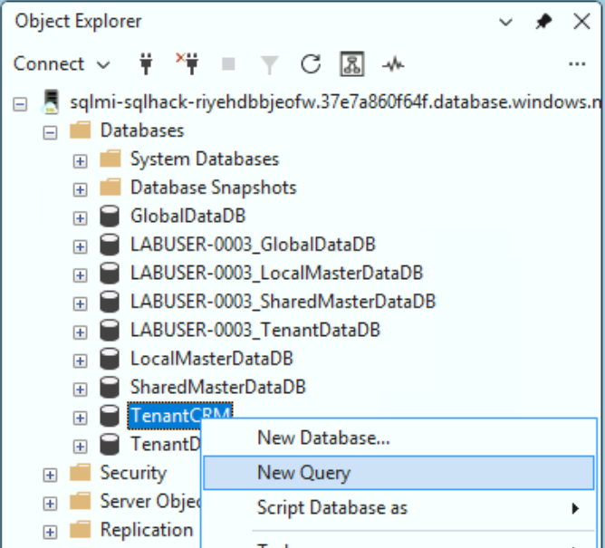|Copilot uses the connection of the active query window as context.|

## 2.3 Open the GitHub Copilot chat

|**Narrative/Instructions**| **Screenshot**| **Notes**|
|:------------|:--------------|:---------|
|Open the GitHub Copilot chat window in SSMS and verify that you are signed in.|||
|Verify that Copilot sees your database context by asking a first question.||**Prompt**: *"Which database am I connected to and which tables, views and stored procedures does it contain?"*|

> **Prompting tips (from Challenge 2)**
> * Be specific about the database and the goal.
> * Ask Copilot to explain how it came to a conclusion.
> * Ask for scripts first and tell Copilot **not to execute** changes. Review everything before you run it.
> * Copilot may ask for approval before it executes queries. Read the query and approve it.
> * GitHub Copilot in SSMS cannot see the Azure Portal. Use it there as a guide that explains terms and findings.

# 3. Get a first security overview with GitHub Copilot

Before we look at the individual security features, let Copilot give us a first overview of the security posture of the database. This is also a good way to explain the layered security model.

|**Narrative/Instructions**| **Screenshot**| **Notes**|
|:------------|:--------------|:---------|
|Ask Copilot to explain the layered security model of Azure SQL Managed Instance.|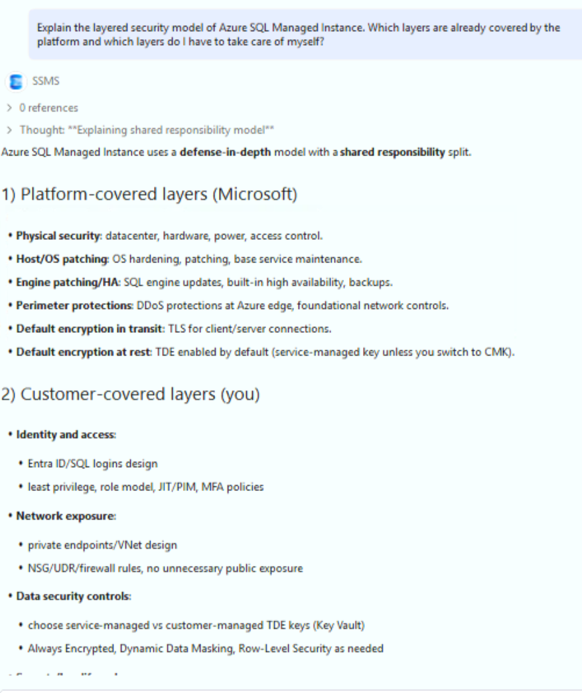|**Prompt**: *"Explain the layered security model of Azure SQL Managed Instance. Which layers are already covered by the platform and which layers do I have to take care of myself?"*|
|Ask Copilot to check the database for security issues. Enter a prompt similar to the following into the GitHub Copilot chat window.||**Prompt**: *"Please check for security issues and options to mitigate them in the TenantCRM database."*|
|GitHub Copilot may request approval several times to execute queries to analyze the problem. Please approve the requests.|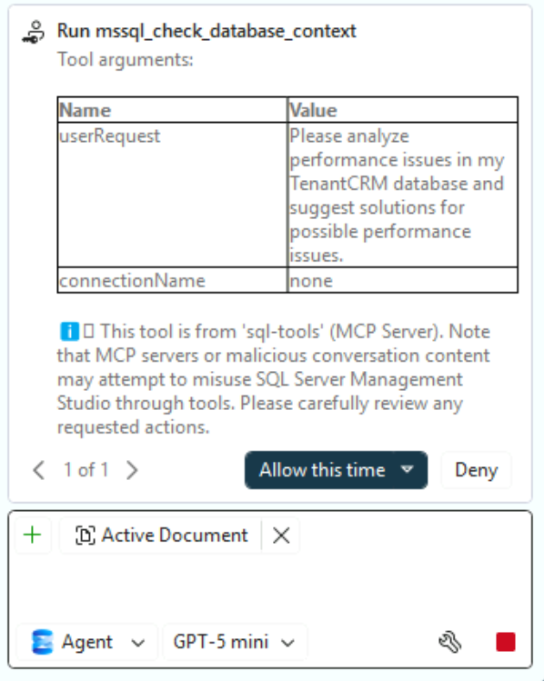|**Note**: Look at the queries Copilot executes. They read metadata, for example about permissions, stored procedures, and database configuration.|
|Copilot gives you a list of findings. **Keep this list.** We will come back to it in section 7 and compare it with the findings of the Azure tools.|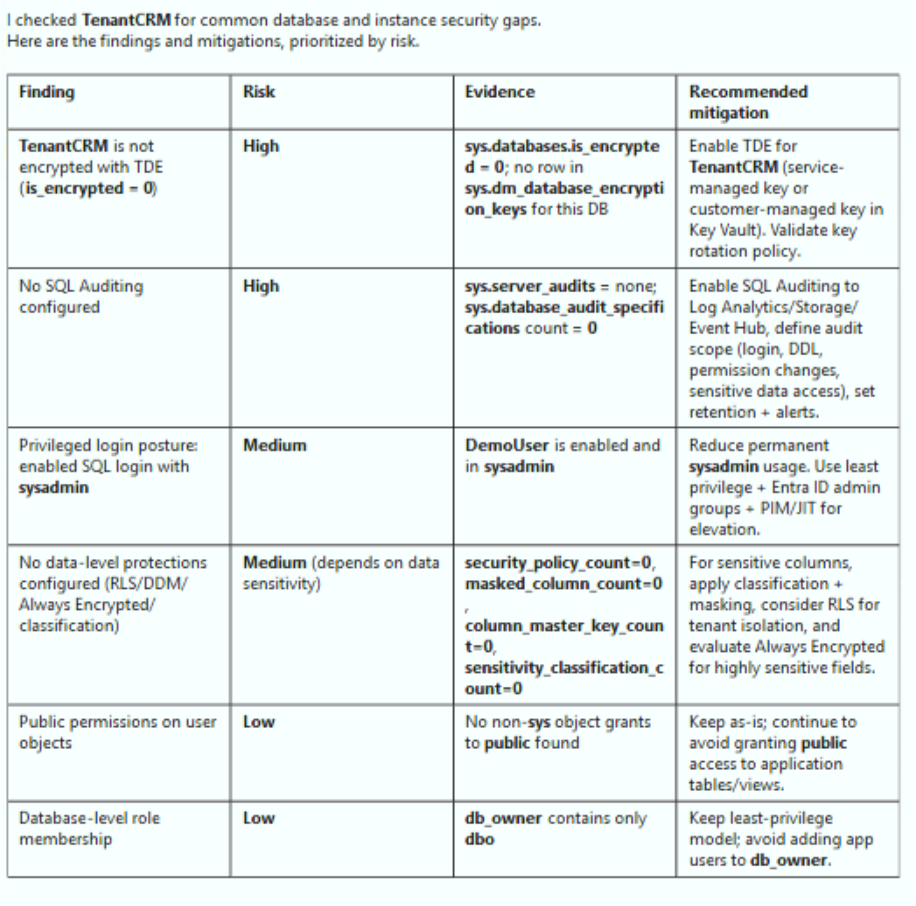|**Prompt**: *"Please summarize the findings in a table with the columns finding, risk, affected object and recommended action. Sort by risk."*|

# 4. Data Discovery & Classification

Data Discovery & Classification is a built-in capability for discovering, classifying, labelling and protecting sensitive data in databases. It can be used to support many use cases including financial, healthcare, personally identifiable (PII) data and help meet data privacy standards and regulatory compliance.

More information on Data Discovery & Classification can be found in the [official documentation](https://docs.microsoft.com/en-us/azure/azure-sql/database/data-discovery-and-classification-overview).

|**Narrative/Instructions**| **Screenshot/Code**| **Notes**|
|:------------|:--------------|:---------|
|Ask Copilot to explain the feature before you use it.||**Prompt**: *"What is Data Discovery & Classification in Azure SQL and what is the difference between an information type and a sensitivity label?"*|
|Ask Copilot to find potentially sensitive columns in your database. You will compare the result with the recommendations of the Azure Portal.|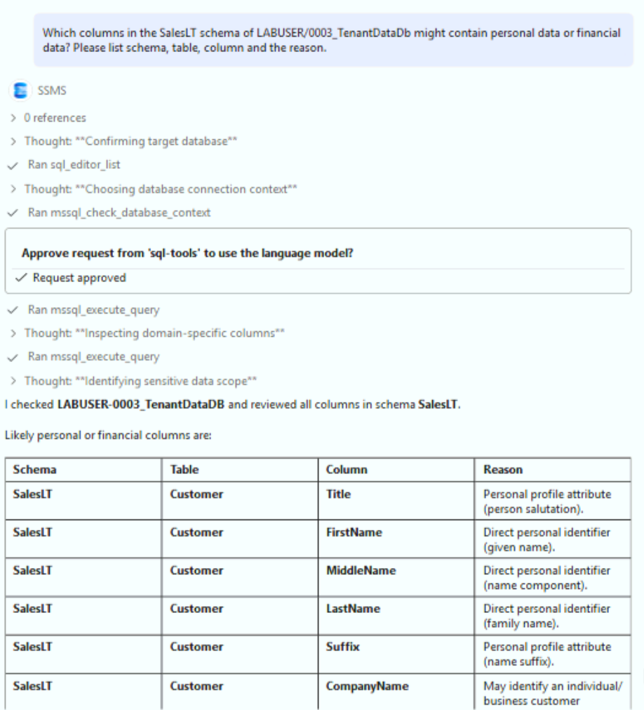|**Prompt**: *"Which columns in the SalesLT schema of \<Team\>_TenantDataDb might contain personal data or financial data? Please list schema, table, column and the reason."*|

## Viewing Data Classification Recommendations

Whenever a database is deployed or schema changes are made to an existing database, the Data Discovery & Classification engine automatically performs a scan to identify columns that may potentially contain sensitive data.

|**Narrative**| **Screenshot/Code**| **Notes**|
|:------------|:--------------|:---------|
|Within the Azure Portal navigate to the shared Azure SQL Managed Instance screen. Scroll down to the list of databases and click on your teams **\<Team\>_TenantDataDb** database.|||
|On the blade on the left, under the **Security** section click **Data Discovery & Classification**.|||
|The Data Discovery and Classification **Overview** shows that no data classifications have been made but based on the automatic classification scan there are a number of potential data classification recommendations as shown at the top of the report. Click the blue information bar (highlighted in yellow) to view the data classification recommendations.|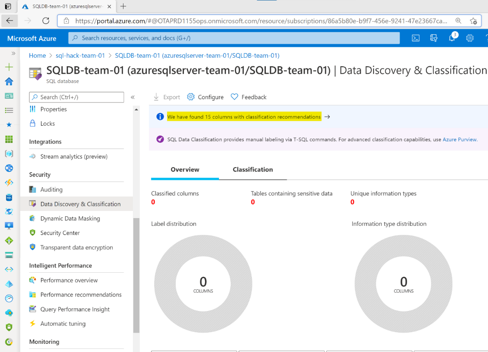||
|The recommendations show the name of the schema, table and column with intelligent information type classification and sensitivity recommendations. As can be seen the **Customer** table in the **SalesLT** schema contains the columns **FirstName** and **LastName**. The initial data classification scan has identified that the **Information type** of these columns from a data classification perspective is **Name** and the **Sensitivity Label** for these columns is recommended to be **Confidential – GDPR**.|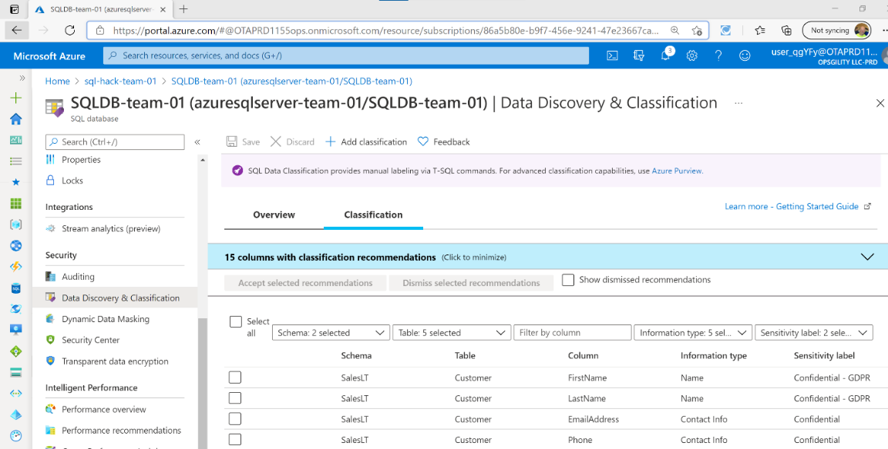|Compare the recommendations with the list from Copilot. Did Copilot find additional columns?|
|Select the **FirstName** and **LastName** classification recommendations by selecting the recommendation rows, click **Accept selected recommendations** and then click **Save**. Click the **Overview** tab on the Data Discovery & Classification report to look at the saved data classifications. There are now two columns classified from the Customer table with the information type of **Name** and the sensitivity label **Confidential – GDPR**.| 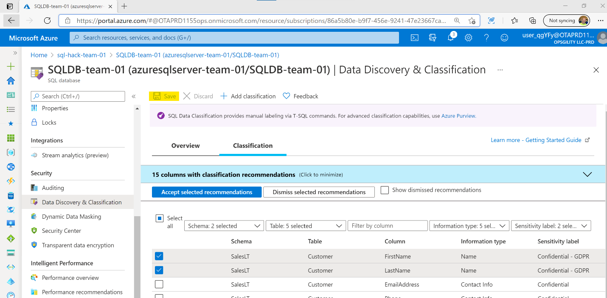||
|Now let’s add a custom data classification which is not based on the auto recommendations. Switch back to the **Classification** tab at the top of the report and click **+ Add classification**.| 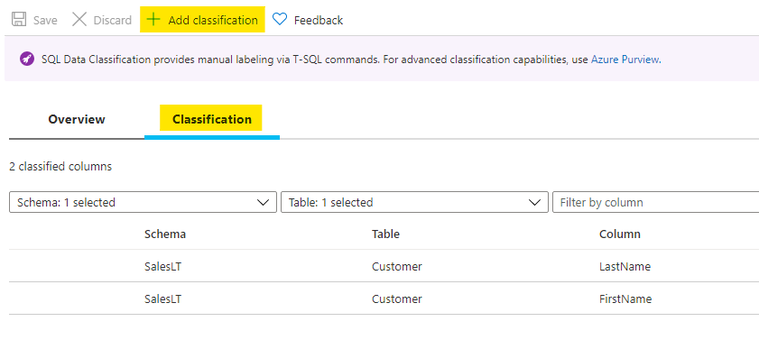||
|On the **Add Classification** blade on the far right of the screen set the following values and then click **Add Classification** and then **Save** to save your new classification. Click the **Overview** tab to look at the saved data classifications.     **Schema name**: 	SalesLT   **Table name**: 	Product   **Column name**: 	ListPrice   **Information type**: 	Financial   **Sensitivity Label**: 	Highly Confidential     **Click:** 	Add Classification  **Click:** 	Save |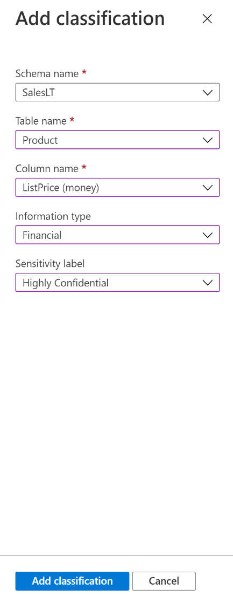||
|In SSMS open a new T-SQL query window connected to your **\<Team\>_TenantDataDb** database and run the SELECT statements shown on the right.|<code>-- 1 Data Discovery & Classification SELECT &nbsp;&nbsp;c.FirstName, &nbsp;&nbsp;c.LastName, &nbsp;&nbsp;c.* FROM SalesLT.Customer c; SELECT &nbsp;&nbsp;p.ListPrice FROM SalesLT.Product p;</code>||
|Nothing out of the ordinary happens - two simple result sets are returned containing the FirstName, LastName and ListPrice columns.||Ask Copilot why the classification did not change the result. **Prompt**: *"I classified the columns FirstName, LastName and ListPrice. Why can I still read them with a simple SELECT? How do I really protect sensitive columns?"*|
|Ask Copilot how to turn classification into real protection.|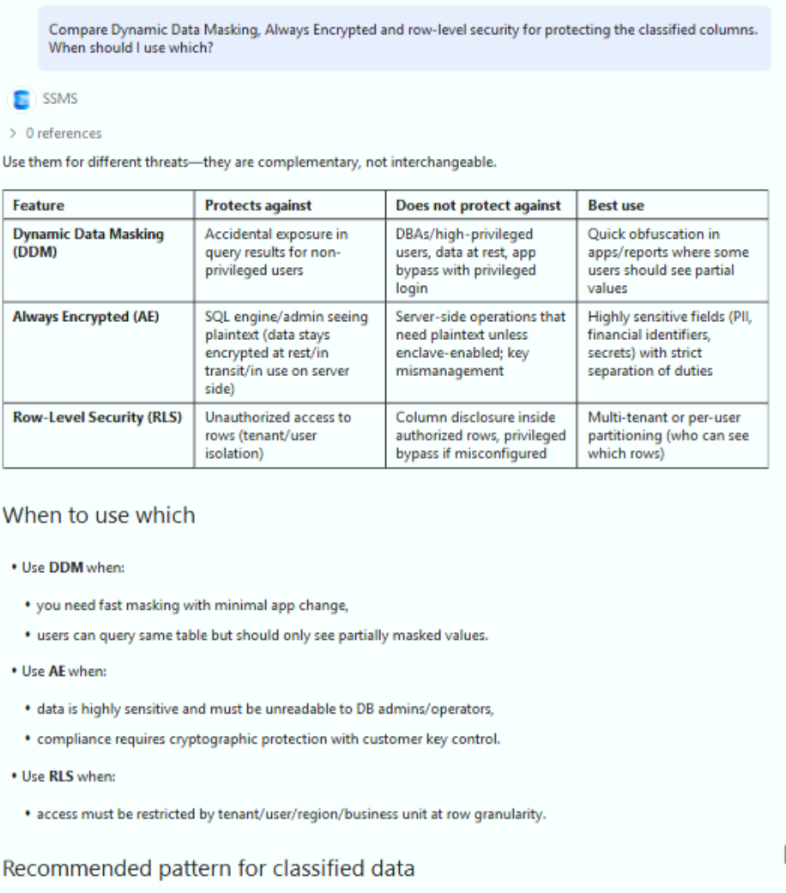|**Prompt**: *"Compare Dynamic Data Masking, Always Encrypted and row-level security for protecting the classified columns. When should I use which?"*|

**REMEMBER: Data Discovery and Classification is not a security mechanism – it’s a data tagging and management tool.**

# 5. Azure Defender for SQL: Vulnerability Assessment

When provisioning an Azure SQL Managed Instance or an Azure SQL Database logical server there is the option to enable the security feature Azure Defender for SQL.

This security feature offers two security components:

- Vulnerability Assessments
- Advanced Threat Protection

This section focuses on Vulnerability Assessments, section 6 deals with Advanced Threat Protection.

A Vulnerability Assessment is an output position (or report) from a vulnerability scan. A Vulnerability Assessment scan is the application of SQL Server best practices based on a rules engine, the goal being to improve the security posture of your Azure SQL Managed Instance or Azure SQL Database. The first scan will produce the initial vulnerability scan baseline. The first scan happens automatically once a database is deployed.

More details on Azure SQL vulnerability assessments can be found in the [official documentation](https://docs.microsoft.com/en-us/azure/azure-sql/database/sql-vulnerability-assessment).

|**Narrative**| **Screenshot/Code**| **Notes**|
|:------------|:--------------|:---------|
|Ask Copilot what a vulnerability assessment checks and how it differs from the analysis that Copilot did for you.||**Prompt**: *"What does the Azure SQL Vulnerability Assessment check, and how is a rules-based scan different from your own analysis of my database?"*|
|In the Azure portal navigate to the shared SQL Managed Instance.|||
|Scroll down the Overview screen until you see the list of databases and click on your **\<Team\>_TenantDataDB** database.|||
|In the **\<Team\>_TenantDataDB** database screen, on the left hand blade click **Microsoft Defender for Cloud** in the Security section.    Scroll down the screen to the bottom and click the **View additional findings in Vulnerability Assessment** link.| **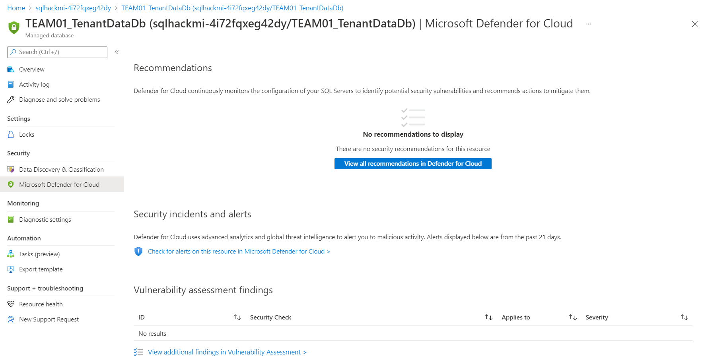**||
|The Vulnerability Assessment page can be used to run a scan, view scan history and will show the number of checks that have been passed and failed for the last scan with failed checks listed in the table below.   Run a scan if prompted to do so which should only take a few minutes.|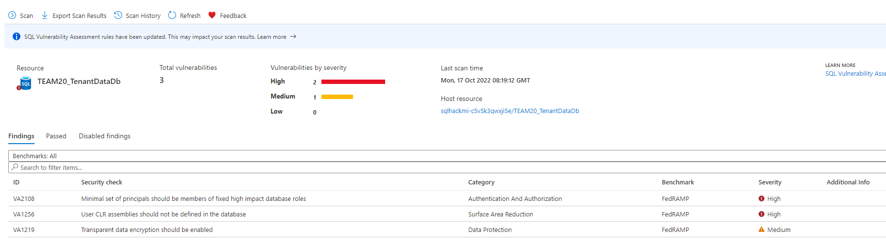||
|Review the lists of passed and failed checks. Notice that the report is specific to the database you ran the scan for but does also include events against the system database and therefore flag server configuration issues.|||
|Pick a failed check and ask Copilot to explain it. Copy the rule ID and the title of the finding into the prompt.|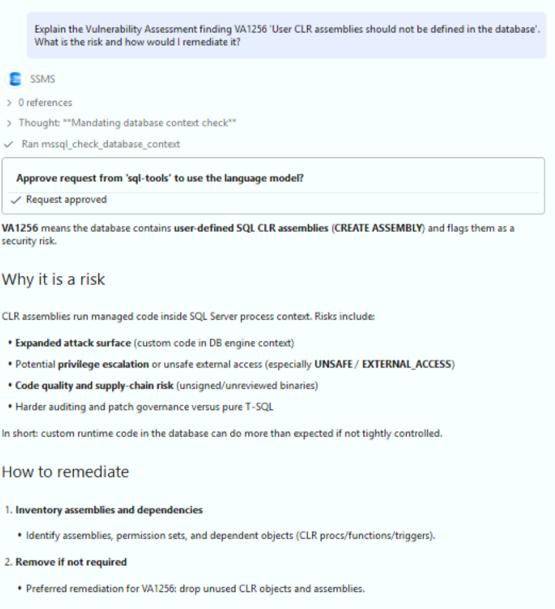|**Prompt**: *"Explain the Vulnerability Assessment finding VA1256 'User CLR assemblies should not be defined in the database'. What is the risk and how would I remediate it?"*|
|In the **Findings** tab, which lists the failed checks, click on finding: **ID:** VA1256 **Security Check:** User CLR assemblies should not be defined in the database.|||
|Note the detailed report lists the rule’s details, the offending CLRs and a remediation script to remove them.   However, because these 2 CLRs are an integral part of our migrated legacy application we need to keep them. But equally we don’t want them to be continuously flagged as an issue in the Vulnerability Assessment reports. To do this we can add exceptions to the Vulnerability Assessment’s baseline position.| **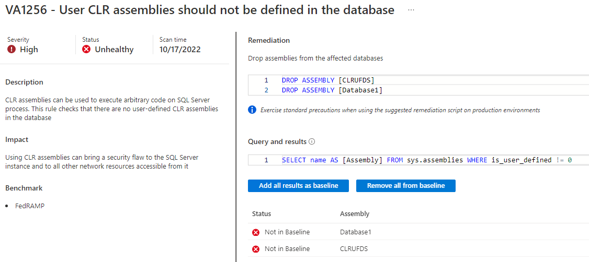**|**Prompt**: *"My legacy application needs two user CLR assemblies. What are the risks and which compensating controls should I put in place if I keep them?"*|
|On the details page for VA1256 click **Add all results as baseline** and select **Yes** in the Set baseline message. Adding the results as the baseline will update the Vulnerability Assessment rules engine to accept the current CLR Assemblies as allowable and set a new baseline position for the rule.     Notice, in the upper side of the details page for VA1256, a warning saying there are pending baseline changes. Run a new scan to see updated results.|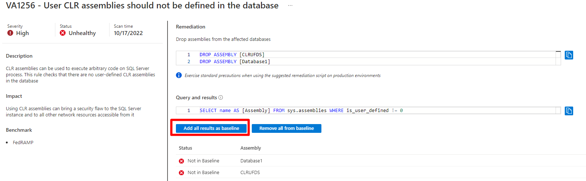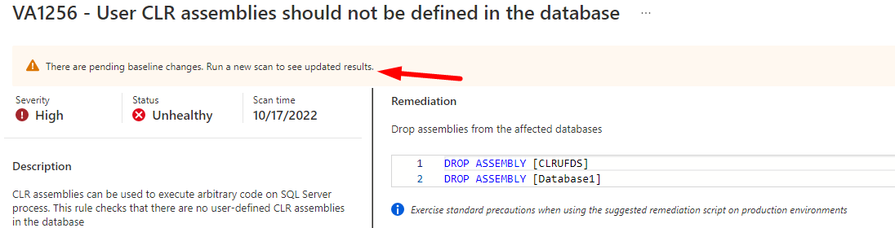||
|Close the details page for VA1256 to get back to the Assessment summary page and notice the same warning.|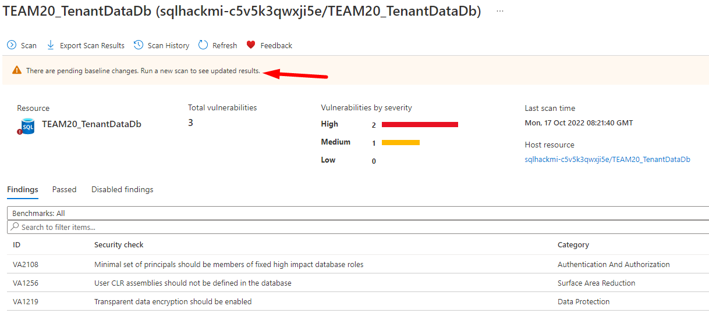||
|Click the **Scan** button to run a manual scan which will take about a minute. Once the scan completes the finding VA1256 will be removed from the Findings list.  When making changes to a Vulnerability Assessment baseline it may be necessary for compliance reasons to export a Scan Findings report to show the security posture of the Azure SQL Database in relation to the amended baseline.    To export the results of a scan to reflect the current baseline click **Export Scan Results** at the top of the portal screen:  **NOTE: Excel is \*not\* installed on your lab VMs** *so you will have to copy the report to your own desktop to have a look at it.*|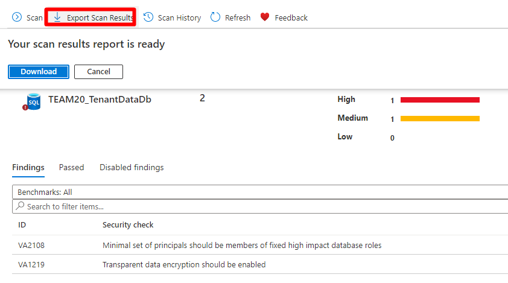||
|Compare the remaining findings of the Vulnerability Assessment with the list that Copilot created in section 3. Which findings were found by both, and which by only one of them?||**Prompt**: *"Here are the remaining findings of my Vulnerability Assessment: [paste the finding titles]. Please prioritize them and tell me which I should fix first."*|

# 6. Azure Defender for SQL: Advanced Threat Protection

The other security component of Azure Defender for SQL is Advanced Threat Protection.

Advanced Threat Protection provides a layer of security that can detect and respond to potential threats as they occur by providing security alerts on anomalous activities. Alerts can be generated based on suspicious database activities, potential vulnerabilities, and SQL injection attacks, as well as anomalous database access and queries patterns.

More information in Azure Defender for SQL – Advanced Threat Protection can be found in the [official documentation](https://docs.microsoft.com/en-us/azure/azure-sql/database/threat-detection-overview).

|**Narrative**| **Screenshot/Code**| **Notes**|
|:------------|:--------------|:---------|
|Ask Copilot to explain SQL injection before you simulate it.||**Prompt**: *"What is a SQL injection attack, and how does Advanced Threat Protection detect it in Azure SQL?"*|
|In the Azure portal navigate to the shared SQL Managed Instance.|||
|Scroll down the Overview screen until you see the list of databases and click on your **\<Team\>_TenantDataDB** database.|||
|In the **\<Team\>_TenantDataDB** database screen, on the left-hand blade click **Microsoft Defender for Cloud** in the Security section. Scroll down to the **Security incidents and alerts** heading – note no incidents or alerts are listed.|**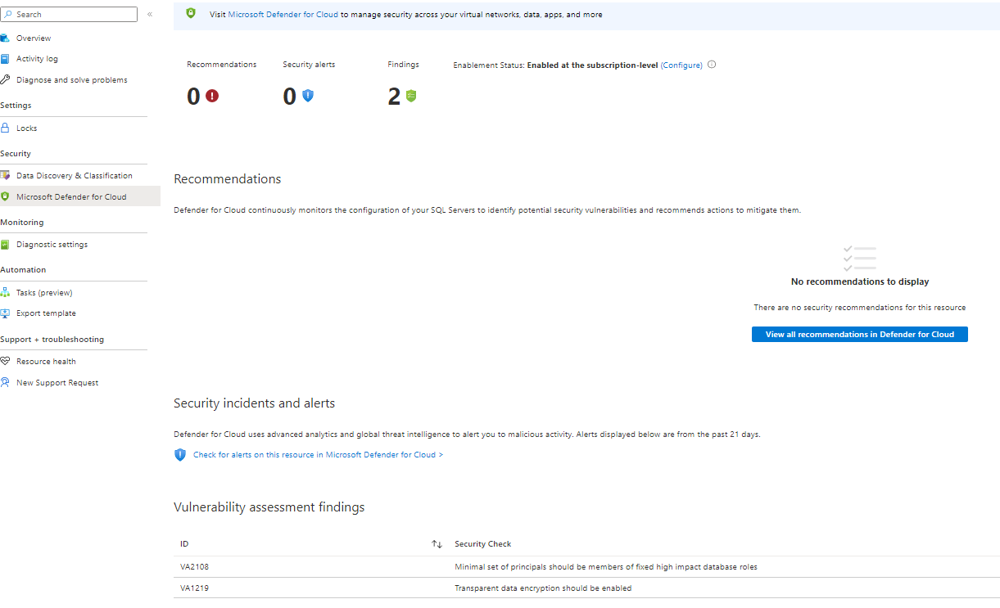**||
|On the team VM, open a new query window in SQL Server Management Studio connected to your **\<Team\>_TenantDataDB** database.|||
|To simulate a potential SQL injection query copy the following SELECT into the new query window **BUT DON’T RUN IT YET**:|<code>--Advanced Threat Protection DECLARE @UserInput nvarchar(max) = ''' OR 1=1--'; DECLARE @SQL nvarchar(max) = 'SELECT * FROM sys.databases WHERE name = ''' + @UserInput + ''''; EXEC(@SQL);</code>|Notice that the logic in the WHERE clause will always equate to true and the positioning of single-quotes including in the comment represents a potential SQL injection vulnerability. **Prompt**: *"Explain why this script is vulnerable to SQL injection and how to write it safely."* (select the script in the editor first)|
|Before running the query change the connection properties as shown on the right using the **Query\\Connection\\Change Connection**… menu in SSMS.  Click **Connect**.| Specify the name of the team Azure SQL Database: **\<Team\>_TenantDataDB**  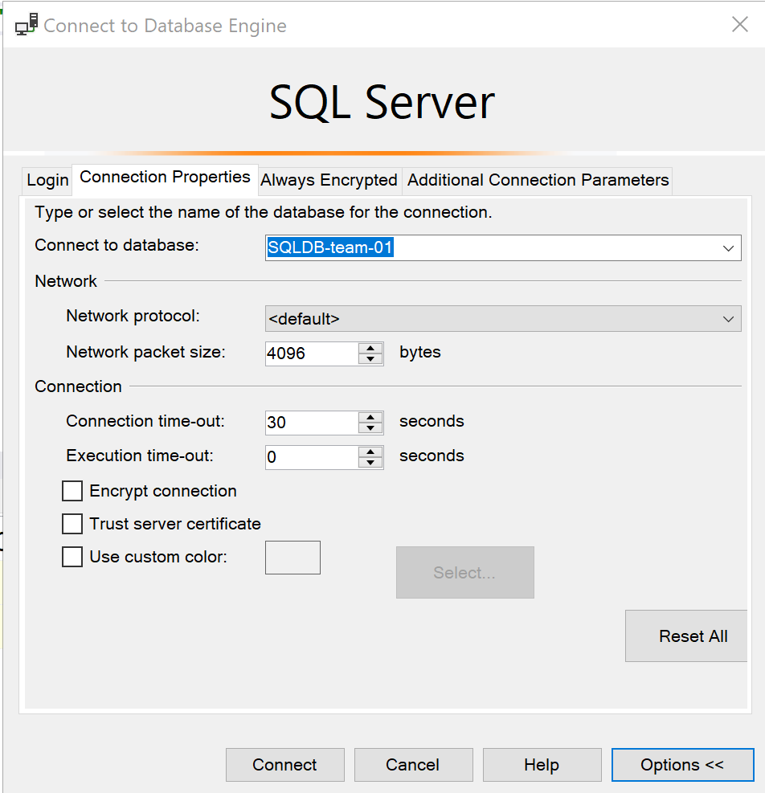   On **Additional Connection Parameters** add a connection string option to specify the application name: **Application Name=webappname**   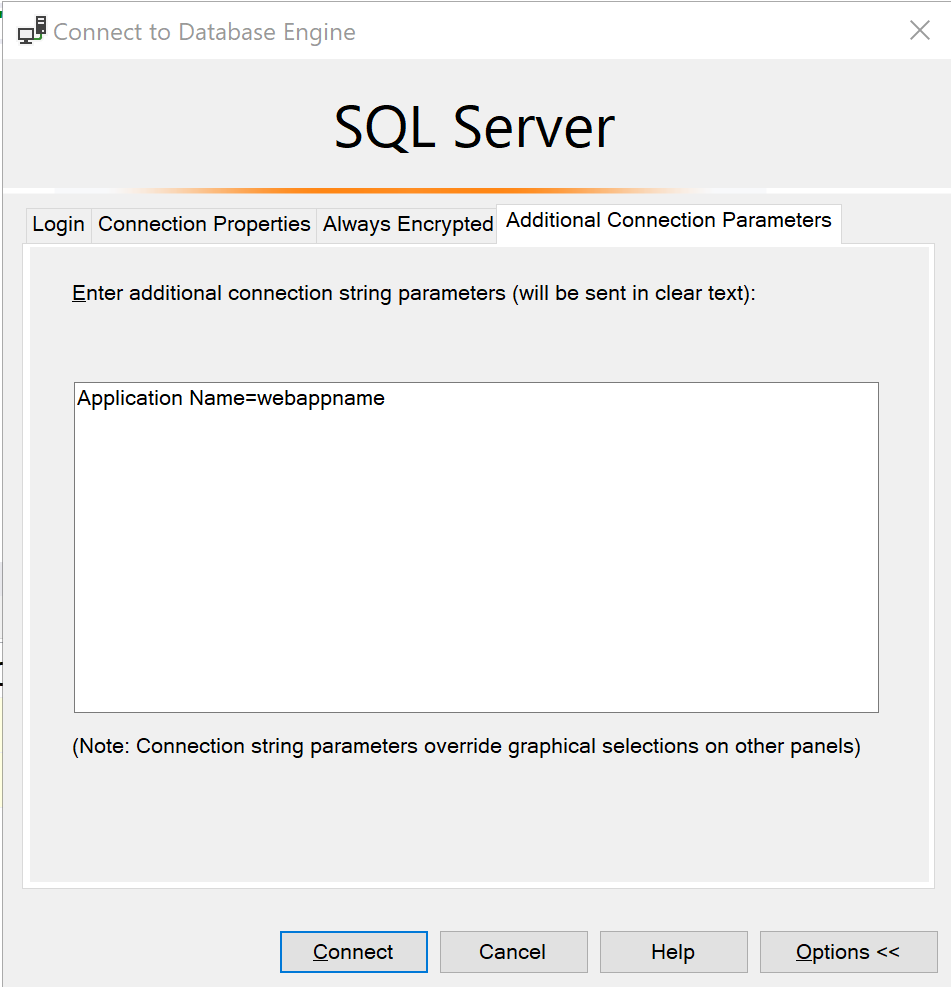 ||
|Run the query.    It will return a list of databases on the server.|||
|Back in the Azure Portal **Microsoft Defender for Cloud** screen, after a few minutes an alert should be generated.|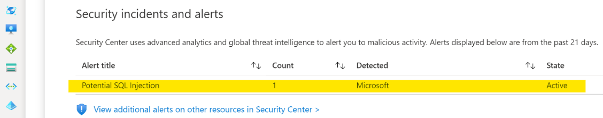|**NOTE:** It might take up to 10 minutes for the alert to appear in the portal.|
|Once the alert appears click on it to see the details.    Depending on the progress of other teams you may see multiple entries in the details table.|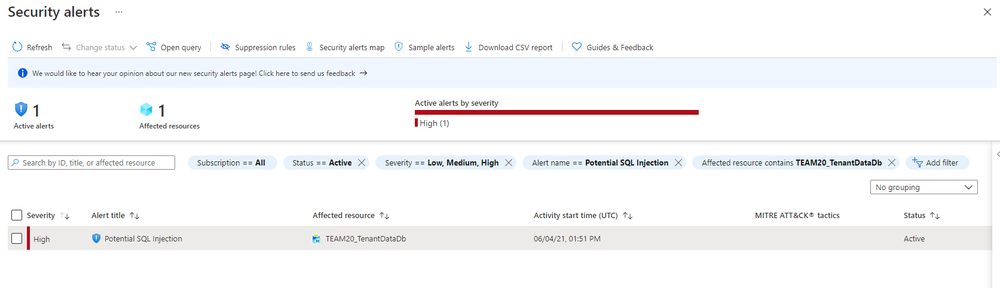||
|Try clicking on the alert.   Note that you can drill further into the alert to see more details, get explanations and links to documentation on the alert and even advice on how to negate and remediate the problem.|||
|Ask Copilot to help you with the interpretation of the alert.|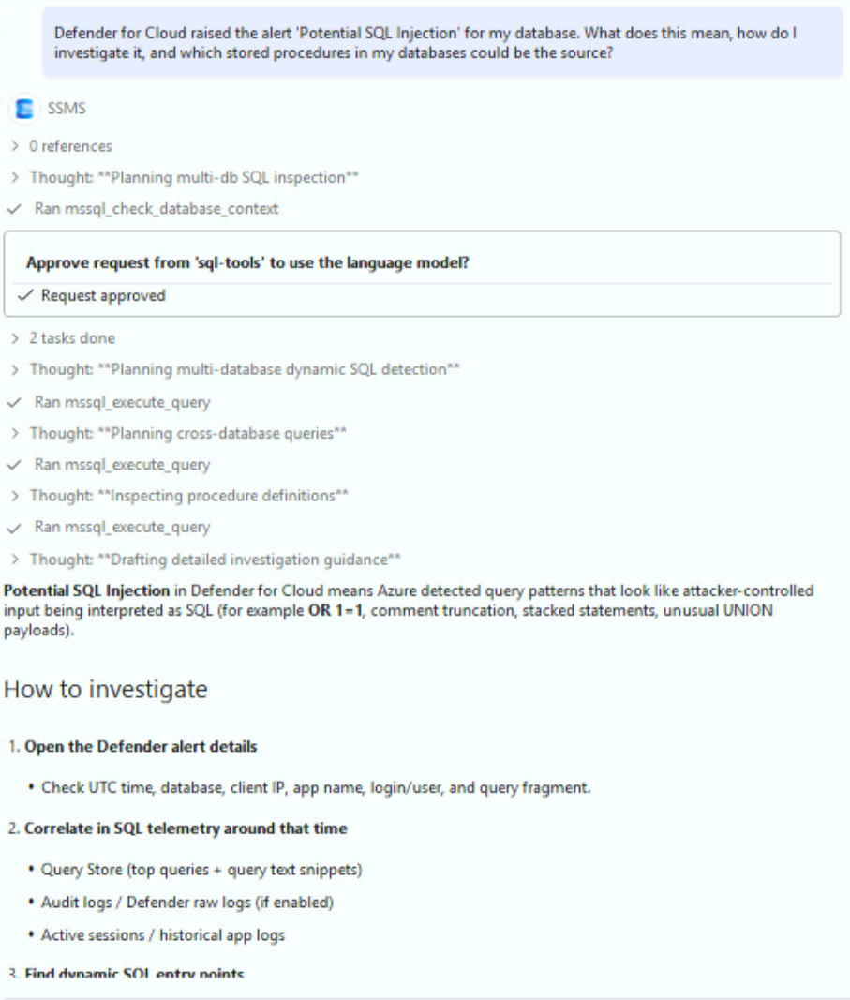|**Prompt**: *"Defender for Cloud raised the alert 'Potential SQL Injection' for my database. What does this mean, how do I investigate it, and which stored procedures in my databases could be the source?"*|

# 7. Fix the SQL injection vulnerability with GitHub Copilot

In this section we close the loop. The simulated attack showed what a SQL injection looks like. Now we use Copilot to find the vulnerable code in the **TenantCRM** database and fix it.

|**Narrative/Instructions**| **Screenshot**| **Notes**|
|:------------|:--------------|:---------|
|Go back to the findings list from section 3. GitHub Copilot identified the stored procedure **AdminExecuteSQLCommand** to be vulnerable to SQL code injection. Copilot recommends to use **sp_executesql** for proper parameter handling.|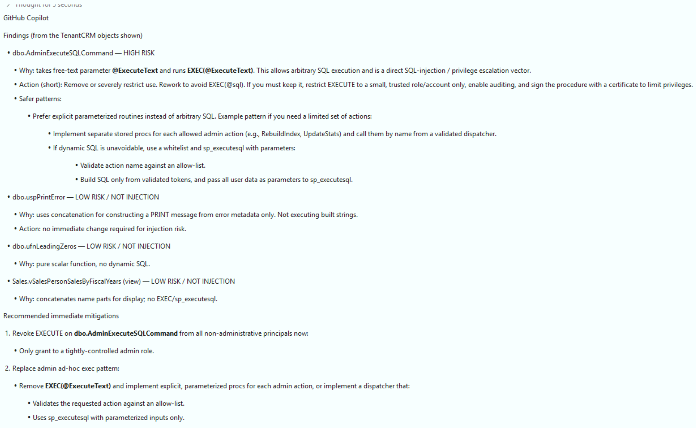|**Note**: If your list does not show this finding, ask Copilot specifically for it with the prompt in the next row.|
|Ask Copilot to search for dynamic SQL in the whole database.|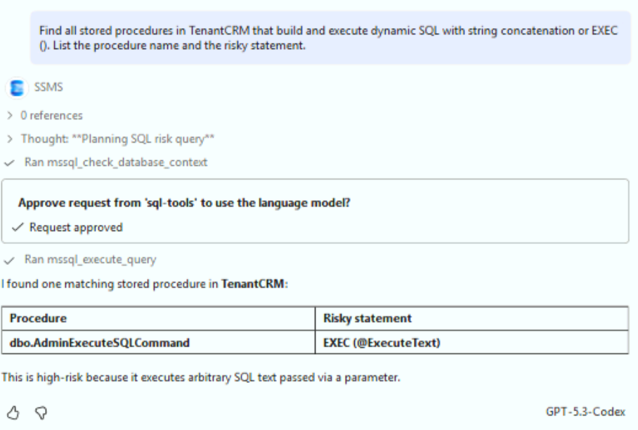|**Prompt**: *"Find all stored procedures in TenantCRM that build and execute dynamic SQL with string concatenation or EXEC(). List the procedure name and the risky statement."*|
|Ask Copilot to explain the vulnerability in AdminExecuteSQLCommand.|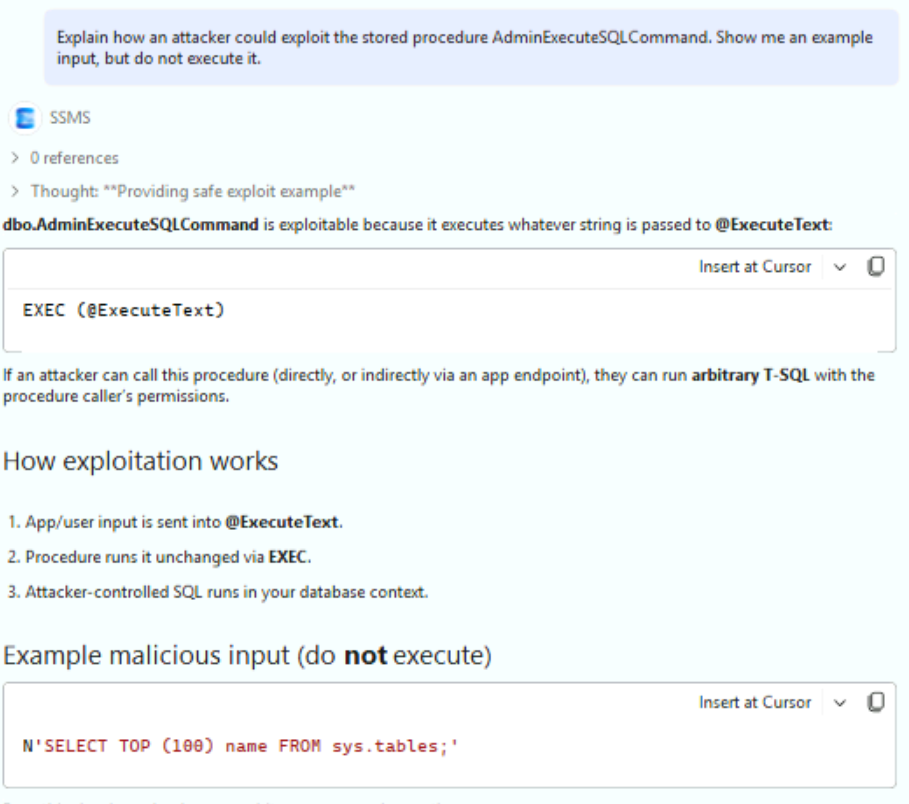|**Prompt**: *"Explain how an attacker could exploit the stored procedure AdminExecuteSQLCommand. Show me an example input, but do not execute it."*|
|Ask Copilot for a safe version of the procedure. Tell Copilot not to execute the script.|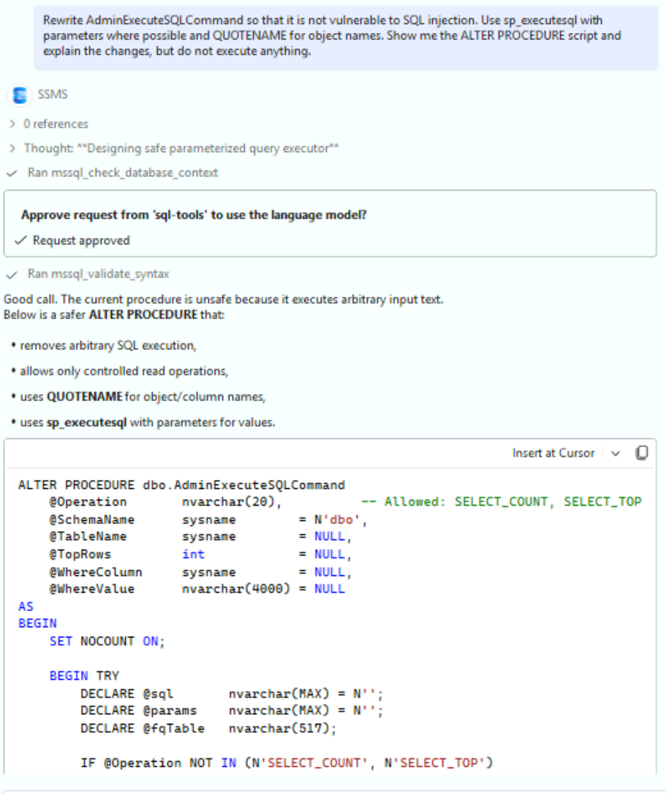|**Prompt**: *"Rewrite AdminExecuteSQLCommand so that it is not vulnerable to SQL injection. Use sp_executesql with parameters where possible and QUOTENAME for object names. Show me the ALTER PROCEDURE script and explain the changes, but do not execute anything."*|
|Review the script. Ask Copilot critical follow-up questions before you apply it.||**Prompt**: *"Does the new version change the behavior for legitimate callers? Which permissions should I restrict on this procedure?"*|
|Execute the **ALTER PROCEDURE** script in the query window connected to **TenantCRM**.|<!---->||
|Verify the fix. Ask Copilot to test the procedure with a harmless input and with the injection example.|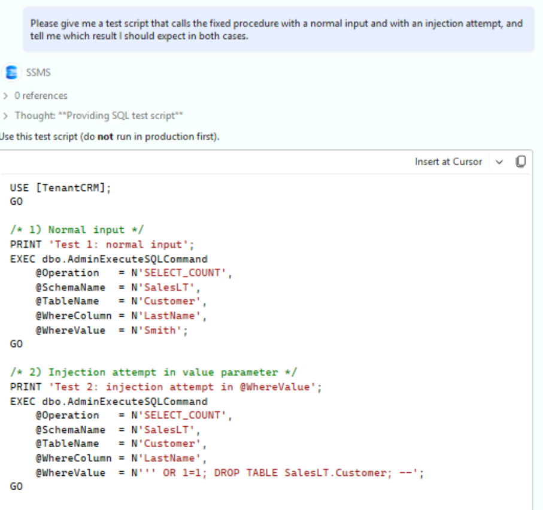|**Prompt**: *"Please give me a test script that calls the fixed procedure with a normal input and with an injection attempt, and tell me which result I should expect in both cases."*|
|Optional: Ask Copilot for further hardening measures.|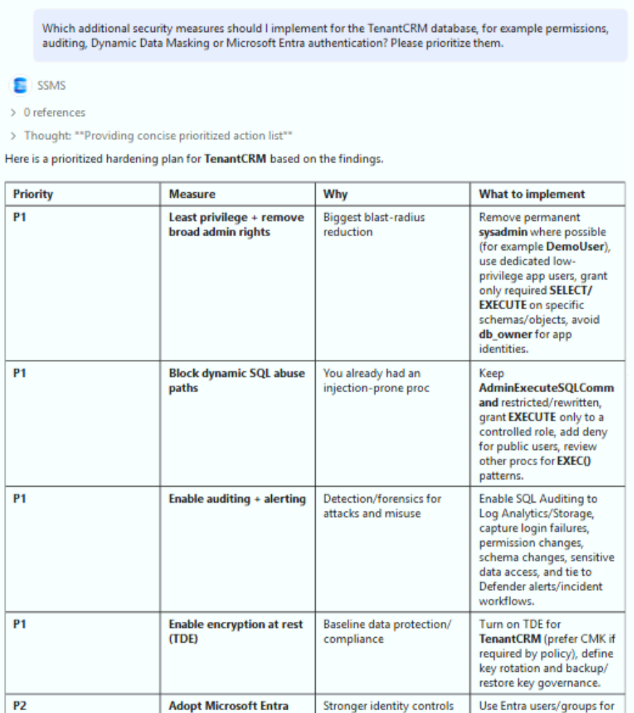|**Prompt**: *"Which additional security measures should I implement for the TenantCRM database, for example permissions, auditing, Dynamic Data Masking or Microsoft Entra authentication? Please prioritize them."*|

We have seen how GitHub Copilot can help us analyze and mitigate security issues, and how the Azure security features help us to verify the results and to detect attacks.

# Prompt cheat sheet

| Goal | Example prompt |
|:-----|:---------------|
| Understand the context | *"Which database am I connected to and which tables, views and stored procedures does it contain?"* |
| Get a security overview | *"Please check for security issues and options to mitigate them in the TenantCRM database."* |
| Structure the result | *"Please summarize the findings in a table with the columns finding, risk, affected object and recommended action."* |
| Find sensitive data | *"Which columns in the SalesLT schema might contain personal data or financial data?"* |
| Explain a finding | *"Explain the Vulnerability Assessment finding VA1256. What is the risk and how would I remediate it?"* |
| Prioritize | *"Here are my remaining findings: [...]. Please prioritize them and tell me which I should fix first."* |
| Find vulnerable code | *"Find all stored procedures in TenantCRM that build and execute dynamic SQL with string concatenation or EXEC()."* |
| Fix safely | *"Rewrite this stored procedure so that it is not vulnerable to SQL injection. Show me the script and explain the changes, but do not execute anything."* |
| Verify the fix | *"Please give me a test script that calls the fixed procedure with a normal input and with an injection attempt."* |
| Harden further | *"Which additional security measures should I implement for this database? Please prioritize them."* |
